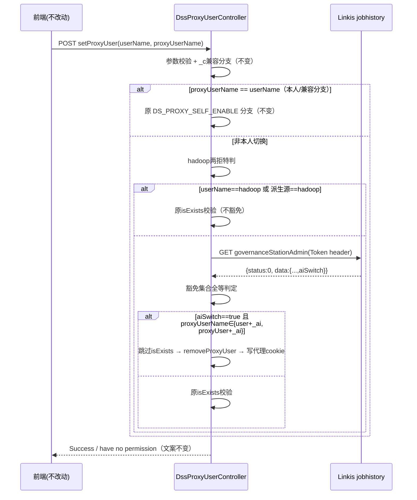

# 新增AI用户切换（aiSwitch开启时免代理授权校验，直接切换至_ai用户） - 设计文档

## 文档信息
- **文档版本**: v1.1（Stage 2.1 检视后修订：OPT-D1 DTO 定论化 + OPT-D2 部署清单补责任人时限）
- **最后更新**: 2026-11-12
- **维护人**: ryanchen（主会话内联生成，des-enhance-feature 子代理因模型白名单403降级）
- **文档状态**: 草稿
- **需求类型**: ENHANCE
- **功能属性**: 后端
- **前端开发类型**: N/A
- **设计文档类型**: 单一设计文档（后端）
- **需求文档**: [REQ-01_新增AI用户切换（aiSwitch开启时免代理授权校验，直接切换至_ai用户）_需求.md](../requirements/REQ-01_新增AI用户切换（aiSwitch开启时免代理授权校验，直接切换至_ai用户）_需求.md)

---

## 执行摘要

### 设计目标

| 目标 | 描述 | 优先级 |
|-----|------|-------|
| G1 | aiSwitch=true 时对「当前用户+_ai」「当前代理用户+_ai」目标豁免 isExists 授权校验 | P0 |
| G2 | governanceStationAdmin 查询失败全情形降级，aiSwitch=false 时与现网逐字节一致 | P0 |
| G3 | hadoop 两拒硬约束（请求者 hadoop 或派生源 hadoop 均不豁免） | P0 |

### 核心设计决策

| 决策点 | 选择方案 | 决策理由（一句话） | 替代方案 |
|-------|---------|------------------|---------|
| 调用范式 | 复用既有先例（CONF_GOVERNANCE_ADMIN_PATH + HttpClientUtil + Token 认证） | Stage 1.6 已核实 HttpResourceManageClient.checkSuperAdmin 生产先例，零新配置项、零新客户端 | 新写 Feign/RestTemplate 客户端（否：引入新范式与超时语义） |
| 调用封装 | dss-framework-proxy-user-service 内独立私有方法 | 先例非 200 抛 DSSRuntimeException，与豁免链路"降级不抛"语义冲突，不能直接复用该方法 | 直接调用 HttpResourceManageClient.governanceStationAdmin（否：异常语义冲突） |
| aiSwitch 解析 | GovernanceStationAdminResponse.Data 追加 `Boolean aiSwitch` 字段 | Gson 反序列化缺失字段自然返回 null，降级语义零成本且对既有调用方（checkSuperAdmin）向后兼容 | 独立 DTO（否：重复建模同一响应体） |
| 豁免判定位置 | setProxyUserCookie 内 isExists 校验前插入前置判断 | 改动面最小（单方法单分支），本人切换分支与参数校验零触碰 | Service 层改 isExists（否：波及全部调用方） |
| hadoop 两拒 | 判定次序最先（先于 aiSwitch 查询） | 硬约束需在最小计算路径上短路，且 hadoop 不应触发外部调用 | 放入豁免集合判定（否：仍会先查 aiSwitch，多一次外部调用） |

### 架构概览图

```
┌──────────────┐  POST /dss/scriptis/proxy/setProxyUser  ┌─────────────────────────┐
│ 前端(不改动) │ ───────────────────────────────────────> │ DSS scriptis-server      │
└──────────────┘                                          │ ScriptisProxyUserCtrl   │
                                                          │ (继承基类)               │
                                                          └──────────┬──────────────┘
                                                                     │ 1 hadoop两拒特判
                                                                     │ 2 GET governanceStationAdmin
                                                                     ▼
                                                          ┌─────────────────────────┐
                                                          │ linkis-mg 网关           │
                                                          │ → linkis-jobhistory     │
                                                          │   data.aiSwitch (新增)  │
                                                          └──────────┬──────────────┘
                                                                     │ 3 aiSwitch判定
                                                                     ▼
                                                          ┌─────────────────────────┐
                                                          │ 豁免→跳过isExists        │
                                                          │ 未命中/降级→原isExists   │
                                                          └─────────────────────────┘
```

### 关键风险与缓解

| 风险 | 等级 | 缓解措施 |
|-----|------|---------|
| R-001 Linkis 依赖不可用/缺 aiSwitch 字段 | 高 | 全失败情形降级 aiSwitch=false，warn 留痕（URL/异常/耗时） |
| R-002 豁免范围误放大越权 | 高 | 精确全等集合判定 + hadoop 两拒次序最先 + AC2.2 边界用例 |
| R-003 继承方 release 路由行为变化 | 高 | 回归范围显式纳入 release-server 继承路由 |
| R-004 基址/超时配置缺陷致静默失效 | 高 | 复用既有 CONF_GOVERNANCE_ADMIN_PATH 与统一超时，无新配置面 |
| R-005 切换请求延迟叠加 | 高 | 内网调用毫秒级；超时上限收敛（见 §2.4 R-005 + 容量） |

### 核心指标

| 指标 | 目标值 | 说明 |
|-----|-------|------|
| setProxyUser 延迟增量 | ≤ 1s | governanceStationAdmin 超时上限以内（正常路径毫秒级） |
| aiSwitch=false 行为一致性 | 100% | 与基线逐字段对拍一致 |
| 豁免判定越权面 | 0 | 仅本人派生目标 + hadoop 两拒 |

---

# Part 1: 核心设计

## 1.1 系统架构设计

### 1.1.1 架构模式与改动定位

**采用模式**：既有分层架构内的单点增强（控制器基类条件分支），不引入新组件、新服务、新中间件。

**代码改动面（唯一模块）**：

| 文件 | 改动类型 | 内容 |
|------|---------|------|
| `dss-framework/dss-framework-proxy-user-service/.../restful/DssProxyUserController.java` | 修改 | setProxyUserCookie 追加豁免前置判断 + 私有 aiSwitch 查询方法 |
| `dss-framework/dss-framework-proxy-user-service/.../dto/AiSwitchResponse.java` | 新增 | 同构轻量响应 DTO（仅 `status` + `data.aiSwitch` 两字段，Gson 反序列化），**定论采纳 OPT-D1**：不修改 GovernanceStationAdminResponse、compute-resource-manager 模块零触碰，避免框架模块间新增编译依赖（依据 §2.6 依赖方向原则） |

### 1.1.2 R-001 + 处理方案（架构/配置/数据承接）

- **处理对象**：setProxyUser 非本人切换链路对 Linkis governanceStationAdmin 的新增同步只读调用（HC-001，详见 http-calls.json）。
- **实施动作**：在 `DssProxyUserController.setProxyUserCookie` 的授权校验前，新增独立私有方法 `queryAiSwitch()`——复用既有先例三要素：①URL 复用 `LinkisConnConf.LINKIS_URL + "/api/rest_j/v1/jobhistory/governanceStationAdmin"`（与 `ResourceManageClient.CONF_GOVERNANCE_ADMIN_PATH` 同源，无新配置项）；②HTTP 客户端复用 `HttpClientUtil.invokeGet(path, headers, null, "utf-8")`（dss-commons/dss-common-server-webank，RequestConfig 自带 connectTimeout/socketTimeout/connectionRequestTimeout 统一超时）；③认证复用 Token header（`LINKIS_RESOURCE_ADMIN_TOKEN_KEY/VALUE` + user key，与 HttpResourceManageClient.java:276-278 同款——rest_j 路径需认证，非 mg 白名单免登录路径）。
- **预期结果**：aiSwitch=true 时豁免链路可用；任何失败情形（不可达/超时/非200/解析失败/字段缺失）返回 false 走原校验，不抛异常、不阻断切换。

**不直接复用 `HttpResourceManageClient.governanceStationAdmin()` 方法的理由**：该方法非 200 时抛 `DSSRuntimeException`（HttpResourceManageClient.java:280-283），与豁免链路"降级不抛"语义冲突；本设计在其同源范式上实现独立的降级语义封装。

### 1.1.3 R-002 + 处理方案（architecture/configuration/data 承接）

- **处理对象**：setProxyUser 授权边界的条件性放宽（isExists 豁免判定）。
- **实施动作**：豁免目标集合按精确全等构造：`{userName + "_ai"}` ∪（当前代理用户非空时 `{当前代理用户 + "_ai"}`）；判定次序：①hadoop 两拒特判（最先）→ ②queryAiSwitch() → ③目标集合全等判定 → ④命中跳过 isExists 直接走清旧 cookie + 写代理 cookie 成功路径。后缀常量 `_ai` 以代码常量定义（与 Linkis `linkis.ai.user.suffix` 默认值对齐，本版本不在 DSS 侧做可配置化，避免新增配置面；若后续 Linkis 侧改后缀，DSS 随版本同步）。
- **预期结果**：豁免仅命中两类本人派生目标；他人派生 `_ai`（otheruser_ai）、任意非 `_ai` 目标全部走原 isExists 校验；本人切换分支（DS_PROXY_SELF_ENABLE）与参数校验零触碰。

### 1.1.4 R-003 + 处理方案（architecture 承接）

- **处理对象**：基类增强逻辑被 ScriptisProxyUserController（/dss/scriptis/proxy）与 dss-framework-release-server-webank ProxyUserController 两个继承控制器同时继承。
- **实施动作**：不修改任何继承方代码；豁免行为经继承自动生效；回归范围显式纳入 release-server 继承路由（§3.4 测试设计）。
- **预期结果**：两个继承路由行为一致且可预期，无代码改动即无新增缺陷面。

### 1.1.5 R-004 + 处理方案（architecture/configuration/data 承接）

- **处理对象**：governanceStationAdmin 调用的基址/超时/认证配置正确性。
- **实施动作**：零新增配置项——基址复用 `LinkisConnConf.LINKIS_URL`（现网已配置且被 checkSuperAdmin 等既有调用使用），超时复用 HttpClientUtil 统一 connectTimeout，认证复用 `LINKIS_RESOURCE_ADMIN_TOKEN_*` 既有配置；上线核对项仅两项：各环境 `LINKIS_RESOURCE_ADMIN_TOKEN_*` 值有效性（运维核对）、scriptis-server→linkis-mg 网络连通性（联调验证）。
- **预期结果**：不出现"新配置漏配致豁免静默失效"的部署缺陷面；配置与既有生产调用完全同源。

### 1.1.6 R-005 + 处理方案（architecture 承接）

- **处理对象**：setProxyUser 用户交互路径新增同步 HTTP 调用的延迟叠加。
- **实施动作**：调用仅在"非本人切换且非 hadoop 两拒"时触发（本人切换与 hadoop 路径零开销）；正常路径为内网/网关毫秒级调用；超时上限由 HttpClientUtil 统一超时兜底（设计确认现值，若现值 >3s 则为该方法单独传入更短超时参数——HttpClientUtil.invokeGet 的超时来自其内部统一值，本设计不改公共工具类，延迟预算验证交测试阶段实测）。
- **预期结果**：正常路径延迟增量毫秒级；最坏情况（超时）阻塞上限 = HttpClientUtil 统一超时值，且降级后本次请求走原校验。

## 1.2 核心流程设计

### 1.2.1 主流程（增强后）



### 1.2.2 R-001 + 异常路径（exception/degradation/architecture 承接）

- **触发条件**：governanceStationAdmin 连接拒绝、读/连超时、HTTP 非 200、JSON 解析失败、`data.aiSwitch` 缺失或非布尔。
- **处理动作**：catch 全部异常类型，`LOGGER.warn` 留痕（完整请求 URL、异常类型/根因、耗时毫秒），返回 `false`。
- **业务结果**：本次请求按 aiSwitch=false 处理，走原 isExists 校验；setProxyUser 响应与现网基线一致（AC3.1/AC1.3）。

### 1.2.3 R-002 + 异常路径（exception/degradation/architecture 承接）

- **触发条件**：aiSwitch=true 但目标为越权目标（他人派生 `_ai`、任意非本人派生后缀用户）。
- **处理动作**：目标集合全等判定不命中 → 走原 isExists 校验；拒绝时沿用现网错误文案 `"user X have no permission to proxy to user Y"`。
- **业务结果**：越权目标被原授权体系拦截；豁免判定无越权放大。

### 1.2.4 R-003 + 异常路径（exception 承接）

- **触发条件**：release-server 继承路由收到 setProxyUser 请求（发布场景调用方）。
- **处理动作**：与 scriptis 路由完全相同的豁免判定链（继承生效，无特判差异）。
- **业务结果**：release 路由行为与 scriptis 一致；调用方未配置授权时按原语义拒绝（不豁免），配置了授权或命中豁免集合时正常切换。

### 1.2.5 R-004 + 异常路径（exception/degradation/architecture 承接）

- **触发条件**：`LINKIS_RESOURCE_ADMIN_TOKEN_*` 配置缺失/值失效、scriptis-server 与 linkis-mg 网络不通。
- **处理动作**：同 R-001 降级路径（catch → warn 留痕 → 返回 false）；启动期不做连通性硬校验（避免阻断服务启动）。
- **业务结果**：豁免能力静默降级为不可用，既有切换行为不受任何影响。

### 1.2.6 R-005 + 异常路径（exception 承接）

- **触发条件**：governanceStationAdmin 响应时间超过 HttpClientUtil 统一超时。
- **处理动作**：超时异常进入 R-001 同一 catch 降级路径。
- **业务结果**：单次请求最坏阻塞 = 统一超时上限；不重试（避免延迟叠加，单次调用语义与开关热加载对齐）。

## 1.3 关键接口定义

### 1.3.1 新增消费接口（Linkis 侧已有，DSS 只读）

```
GET {LinkisConnConf.LINKIS_URL}/api/rest_j/v1/jobhistory/governanceStationAdmin
Headers: Token-User={LINKIS_RESOURCE_ADMIN_TOKEN_KEY}: {LINKIS_RESOURCE_ADMIN_TOKEN_VALUE}
         （与 HttpResourceManageClient 既有调用同款）
Response 200:
{
  "status": 0,
  "message": "success",
  "data": { "admin": ..., "historyAdmin": ..., "deptAdmin": ..., "canResultSet": ..., "errorMsgTip": ..., "aiSwitch": true }
}
```

契约依据：LinkisV2.1.7 REQ-01（release_v2.1.7 commit 81f5fd117）——`aiSwitch` 为 JSON 原生布尔，取自 `linkis.ai.user.enable`（默认 false，热加载）；既有 5 字段不变（仅追加）。

### 1.3.2 响应 DTO 变更

```java
// GovernanceStationAdminResponse.Data 追加（compute-resource-manager-webank 模块）：
private Boolean aiSwitch;   // Gson: 缺失字段 → null；null/false 均按"未开启"处理
public Boolean getAiSwitch() { return aiSwitch; }
public void setAiSwitch(Boolean aiSwitch) { this.aiSwitch = aiSwitch; }
```

对既有调用方 `checkSuperAdmin`（仅读 data.admin）零影响；**定论（OPT-D1）**：proxy-user-service 内定义仅含 `status/data.aiSwitch` 的同构 DTO `AiSwitchResponse`（见 §1.1.1 改动面第 2 项），`GovernanceStationAdminResponse` 不改动、compute-resource-manager 模块零触碰。

### 1.3.3 对外接口（无变更）

`POST /dss/scriptis/proxy/setProxyUser` 入参/出参结构不变；错误文案不变；cookie 产物不变（AC2.3）。

---

# Part 2: 详细设计

## 2.1 豁免判定实现规格

```
setProxyUserCookie(req, resp):
  username = SecurityFilter.getLoginUsername(req)          # 不变
  ... 参数校验 / _c 兼容分支 / workspace 获取（全部不变）...
  if username != proxyUserName:                            # 非本人切换才进入
      derivedSources = {username} ∪ {当前代理用户(非空时)}   # 当前代理用户取自请求 cookie（ProxyUserSSOUtils 口径）
      if "hadoop" in derivedSources:                       # R-002 两拒（最先）
          bypass = false
      else:
          aiSwitch = queryAiSwitch()                        # §2.2 降级语义
          targets = {s + "_ai" for s in derivedSources}
          bypass = aiSwitch and (proxyUserName in targets)   # 精确全等
      if bypass:
          LOGGER.info("user {} bypass proxy authorization by aiSwitch, target {}.", username, proxyUserName)  # R-002 审计
          → 跳过 isExists，直接进入原成功路径
      else:
          → 原 isExists 校验（逐字节不变）
  ... 原成功路径（removeProxyUser + getProxyUserTicketKV + cookie 写入，全部不变）...
```

**当前代理用户读取口径**：与写入同源——`ProxyUserSSOUtils` 既有工具读取请求 cookie 中已生效代理用户（RISK5 闭合）；读取为空（未切换过代理）时集合退化为 `{username}`。

## 2.2 queryAiSwitch() 降级语义规格

```
queryAiSwitch():
  start = now
  try:
    headers = {TOKEN_KEY: TOKEN_VALUE, TOKEN_USER_KEY: ...}     # 复用既有配置
    resp = HttpClientUtil.invokeGet(GOVERNANCE_ADMIN_PATH, headers, null, "utf-8")
    if resp.statusCode != 200:
        warn(URL, "http_status_" + resp.statusCode, elapsed); return false
    parsed = gson.fromJson(resp.body, AiSwitchResponse.class)    # 同构 DTO 或既有 Response
    v = parsed.data?.aiSwitch
    if v == null:
        warn(URL, "field_missing_or_invalid", elapsed); return false
    return v.booleanValue()
  catch (Exception e):                                           # 含超时/连接/解析
    warn(URL, e.getClass().getSimpleName() + ":" + rootCause, elapsed); return false
```

**设计约束落实**：R1.1 实时查询不缓存；R1.2 七种降级情形全覆盖且 warn 含 URL/异常/耗时（OPT-003）；R3.2 超时兜底（HttpClientUtil 统一超时）；R1.3 不携带用户敏感数据（header 仅 Token 与既有先例一致）。

## 2.3 数据设计

无数据库/表结构变更（§7.1 需求文档）；内存对象仅 `Boolean aiSwitch`（请求生命周期内）与豁免目标集合（方法栈内）。dss_proxy_user 授权表零变更。

## 2.4 R-005 + 容量（performance/monitoring 承接）

- **目标负载**：setProxyUser 现网切换请求 QPS 量级（用户交互触发，低频）；governanceStationAdmin 既有调用方（页面初始化高频 + checkSuperAdmin）不受影响——本调用仅在切换时触发，频次远低于既有调用。
- **容量阈值**：延迟增量 ≤1s（需求 §六）；超时上限 = HttpClientUtil 统一超时（设计确认现值）；单次调用不重试。
- **容量证据计划**：测试阶段以降级路径实测耗时（AC3.1 场景）+ 正常路径 TP99 对比作为容量证据（呼应触点① RTEST-PRESSURE-001 缺口）。

## 2.5 兼容性设计

### R-001 + 兼容（compatibility/architecture 承接）

- **兼容对象**：Linkis governanceStationAdmin 响应体（仅追加 aiSwitch，既有 5 字段不变）。
- **兼容策略**：Gson 反序列化对未知字段容忍、缺失字段返回 null；DSS 侧不依赖版本号探测，按"字段缺失=未开启"统一降级——新旧 Linkis 版本共存时行为确定性一致。

### R-002 + 兼容（compatibility/architecture 承接）

- **兼容对象**：既有授权体系（dss_proxy_user 表、isExists 校验、DS_PROXY_SELF_ENABLE 本人分支）。
- **兼容策略**：豁免仅是校验链路上的前置旁路，未命中旁路时原链路逐字节执行；授权管理流程（add/revoke/ITSM 导入）零触碰。

### R-003 + 兼容（compatibility/architecture 承接）

- **兼容对象**：release-server 继承路由及其调用方。
- **兼容策略**：继承方零代码改动；豁免行为对 release 路由调用方透明（多了一条免授权切换的通路，原授权通路保持）；回归显式覆盖 release 路由三种请求（本人/授权切换/无授权拒绝）。

## 2.6 外部依赖设计

| 依赖 | 用途 | 失败语义 | 版本要求 |
|------|------|---------|---------|
| Linkis jobhistory governanceStationAdmin | aiSwitch 开关下发 | 降级 false（§2.2） | ≥ release_v2.1.7（含 aiSwitch 字段）；低版本自动降级 |
| linkis-mg 网关 Token 认证 | rest_j 路径鉴权 | 降级 false（401/403 进 catch） | 既有 LINKIS_RESOURCE_ADMIN_TOKEN_* 有效 |

**模块依赖方向**：proxy-user-service →（仅当复用 Response DTO 时）compute-resource-manager-webank 的 domain 类；设计优先选择同构轻量 DTO（§1.1.1），避免框架模块间新增编译依赖。

## 2.7 降级设计

### R-001 + 降级（degradation/exception/recovery 承接）

- **降级触发**：七情形（连接拒绝/超时/非200/解析失败/字段缺失或非法/Token 失效/网络不通）。
- **降级动作**：返回 aiSwitch=false → 本次请求走原 isExists 校验；warn 留痕（URL/异常/耗时）。

### R-002 + 降级（degradation 承接）

- **降级触发**：aiSwitch=false（配置关闭或部署版本低于 release_v2.1.7）。
- **降级动作**：豁免链路整体旁路，全部请求走原校验（与升级前行为一致）。

### R-003 + 降级（degradation 承接）

- **降级触发**：release 路由下 Linkis 不可用（同 R-001 七情形）。
- **降级动作**：与 scriptis 路由相同降级（继承同一方法，无差异化分支）。

### R-004 + 降级（degradation 承接）

- **降级触发**：配置项缺失/值失效/网络不通（部署缺陷面）。
- **降级动作**：同 R-001 catch-all 降级；上线核对清单（Token 值有效性 + 连通性）作为部署检查项而非启动硬校验。

## 2.8 恢复与回滚设计

### R-001 + 恢复方式（recovery/rollback/exception 承接）

- **恢复触发**：Linkis 恢复可达/部署版本补齐 aiSwitch 字段。
- **恢复动作**：无需任何操作（每次请求实时查询，下一请求自动恢复豁免能力——无缓存无状态）。
- **成功标准**：aiSwitch=true 请求实测豁免成功（AC2.1）。

### R-002 + 恢复方式（recovery 承接）

- **恢复触发**：豁免误判（误放大/误拒绝）在测试或灰度中发现。
- **恢复动作**：代码修复走 git revert/fix 流程；灰度期以 `linkis.ai.user.enable=false` 立即收回豁免入口（Linkis 侧热加载开关，秒级生效）。
- **成功标准**：开关关闭后全部请求走原校验（AC3.2）。

### R-003 + 恢复方式（recovery 承接）

- **恢复触发**：release 路由豁免行为引发业务异常。
- **恢复动作**：同 R-002——Linkis 侧开关关闭即全路由（scriptis+release）收回豁免；无需按路由分别处置。
- **成功标准**：关闭后 release 路由行为回基线。

### R-004 + 恢复方式（recovery/rollback/configuration 承接）

- **恢复触发**：配置错误（Token 失效/基址不可达）且需恢复豁免能力。
- **恢复动作**：修复 `LINKIS_RESOURCE_ADMIN_TOKEN_*` 配置值或网络策略；无代码回滚需求（配置与既有生产调用同源，出错概率收敛于环境问题）。
- **成功标准**：queryAiSwitch 实测返回 true（warn 消失）。

### R-004 + 回滚（rollback 承接，含 R-004-rollback 义务）

- **回滚触发**：DSS 侧代码缺陷（豁免逻辑错误）需版本级回退。
- **回滚动作**：git revert 单提交（唯一模块 dss-framework-proxy-user-service + Response DTO 追加），重新构建发布；无配置/数据回滚（§10.2 需求文档）。
- **验证标准**：回滚后 setProxyUser 全量行为与升级前基线逐字段一致（AC3.3）。

### R-005 + 恢复方式（recovery 承接）

- **恢复触发**：延迟超标告警（见 §2.9）。
- **恢复动作**：先关 Linkis 开关收回豁免（消除延迟源），再定位 Linkis 侧性能；DSS 侧无需回滚。
- **成功标准**：关闭后 setProxyUser 延迟回基线。

## 2.9 监控与可观测设计

### R-001~R-005 + 监控（monitoring/exception 承接，5 条 observability 义务合并承接）

- **监控指标**（复用现有 LOGGER 体系，不引入新监控组件）：
  1. `queryAiSwitch` 降级 warn 日志速率（关键字：URL + 异常类型）——R-001/R-004 健康度；
  2. 豁免命中 info 日志速率（bypass 关键字）——R-002 豁免使用量；
  3. queryAiSwitch 耗时（warn 留痕内含 elapsed）——R-005 延迟观测；
  4. 原有 "have no permission" 日志速率对比——R-002/R-003 拒绝率变化（灰度期应见 _ai 目标拒绝率下降）；
  5. Token 认证失败类 warn（401/403 关键字）速率——R-004 配置健康度；
  6. release 路由 setProxyUser 拒绝率与豁免命中率——R-003 继承路由行为一致性观测（与 scriptis 路由同口径对比）。
- **告警条件**（接现有日志告警平台关键字规则）：
  1. 降级 warn 持续出现（>5 分钟连续）→ Linkis 依赖异常（R-001/R-004）；
  2. 豁免命中日志中出现非预期目标模式 → 越权嫌疑（R-002，人工核查）；
  3. elapsed 接近超时上限频次上升 → R-005 延迟风险；
  4. release 路由拒绝率异常上升 → 路由行为差异人工核查（R-003）；
  5. 认证失败 warn 连续出现 → Token 配置失效，触发部署核对清单（R-004）。
- **留痕格式**：沿用现有 "user {} try to add user proxy cookie, params:{}." 格式族，新增豁免结果字段（R2.3 审计要求）。

## 2.10 竞品对标

（用户跳过设计向竞品分析，本章省略——P3-D 跳过语义，质检不算缺失。）

---

# Part 3: 实施设计

## 3.1 改动文件清单

| # | 文件 | 改动 | 行数量级 |
|---|------|------|---------|
| 1 | dss-framework-proxy-user-service/.../DssProxyUserController.java | 豁免判定 + queryAiSwitch 私有方法 + imports | ~60 行 |
| 2 | dss-framework-compute-resource-manager-webank/.../GovernanceStationAdminResponse.java | Data 追加 aiSwitch 字段（若复用） | ~8 行 |
| 3 | （或）dss-framework-proxy-user-service/.../AiSwitchResponse.java | 同构轻量 DTO（若不复用） | 新文件 ~25 行 |

## 3.2 测试设计（对应需求 AC）

| AC | 测试场景 | 类型 |
|----|---------|------|
| AC1.1/AC1.2 | 联调环境 GET 实测 aiSwitch 读取（true/false 双向） | 集成 |
| AC1.3/AC3.1/AC3.3 | aiSwitch=false 及 Linkis 不可达场景基线对拍（本人/授权/无授权三请求逐字段） | 回归 |
| AC2.1 | alexyang→alexyang_ai 豁免切换成功 + cookie 产物核对（AC2.3） | 功能 |
| AC2.2 | 他人派生 _ai 拒绝；userName=hadoop 拒绝；派生源 hadoop（hadoop_ai）拒绝 | 边界 |
| AC3.2 | 开关关闭时全量请求无豁免副作用 | 回归 |
| §十一.3 | release-server 继承路由三请求回归（R-003） | 回归 |
| §十一.4 | 降级路径耗时实测（R-005 容量证据） | 性能 |

## 3.3 部署与上线核对清单

| # | 核对项 | 责任人 | 执行时限 | 通过标准 |
|---|--------|--------|---------|---------|
| 1 | 各环境 `LINKIS_RESOURCE_ADMIN_TOKEN_*` 值有效性 | 运维（falinhe） | 提测前（2026-11-18） | queryAiSwitch 实测无 401/403 warn |
| 2 | scriptis-server → linkis-mg 网络连通性 | 运维（falinhe） | 提测前（2026-11-18） | GET governanceStationAdmin 200 实测 |
| 3 | 目标集群 Linkis 部署版本 ≥ release_v2.1.7（含 aiSwitch；低版本自动降级不阻断） | 运维（falinhe） | 提测前（2026-11-18） | 部署清单核对记录 |
| 4 | Linkis 侧 `linkis.ai.user.enable` 灰度批次（默认 false，按集群开启） | 运维（falinhe）+ DSS 开发确认 | 灰度窗口（2026-11-26 前） | 灰度集群开关值与计划一致 |
| 5 | aiSwitch=true 端到端实测（alexyang→alexyang_ai 豁免切换） | 开发（ryanchen） | 提测前（2026-11-18） | AC2.1 通过 |

（OPT-D2 采纳：补责任人与执行时限。）

---

## 需求风险响应清单

### 稳定性设计质量结论

**结论：符合标准。**

本设计已完整承接已识别的运营稳定性风险。

### 风险响应

| 风险ID | 等级 | 风险结论 | 关注点及设计响应 | 覆盖结论 |
|---|:---:|---|---|:---:|
| R-001 | 高 | setProxyUser 处理链路内，DSS 后端向 Linkis 查询集群级 `_ai` 能力开关，作为豁免判定的唯一输入可能导致查询失败不影响现有行为（降级为不豁免） | 【处理方案】§1.1.2 - **处理对象**：setProxyUser 非本人切换链路对 Linkis governanceStationAdmin 的新增同步只读调用（HC-001，详见 http-calls.json）。<br>- **实施动作**：在 `DssProxyUserController.setProxyUserCookie` 的授权校验前，新增独立私有方法 `queryAiSwitch()`——复用既有先例三要素：①URL 复用 `LinkisConnConf.LINKIS_URL + "/api/rest_j/v1/jobhistory/governanceStationAdmin"`（与 `ResourceManageClient.CONF_GOVERNANCE_ADMIN_PATH` 同源，无新配置项）；②HTTP 客户端复用 `HttpClientUtil.invokeGet(path, headers, null, "utf-8")`（dss-commons/dss-common-server-webank，RequestConfig 自带 connectTimeout/socketTimeout/connectionRequestTimeout 统一超时）；③认证复用 Token header（`LINKIS_RESOURCE_ADMIN_TOKEN_KEY/VALUE` + user key，与 HttpResourceManageClient.java:276-278 同款——rest_j 路径需认证，非 mg 白名单免登录路径）。<br>- **预期结果**：aiSwitch=true 时豁免链路可用；任何失败情形（不可达/超时/非200/解析失败/字段缺失）返回 false 走原校验，不抛异常、不阻断切换。<br><br>**不直接复用 `HttpResourceManageClient.governanceStationAdmin()` 方法的理由**：该方法非 200 时抛 `DSSRuntimeException`（HttpResourceManageClient.java:280-283），与豁免链路"降级不抛"语义冲突；本设计在其同源范式上实现独立的降级语义封装。<br>【异常路径】§1.2.2 - **触发条件**：governanceStationAdmin 连接拒绝、读/连超时、HTTP 非 200、JSON 解析失败、`data.aiSwitch` 缺失或非布尔。<br>- **处理动作**：catch 全部异常类型，`LOGGER.warn` 留痕（完整请求 URL、异常类型/根因、耗时毫秒），返回 `false`。<br>- **业务结果**：本次请求按 aiSwitch=false 处理，走原 isExists 校验；setProxyUser 响应与现网基线一致（AC3.1/AC1.3）。<br>【恢复方式】§2.8 R-001 + 恢复方式（recovery/rollback/exception 承接）<br><br>- **恢复触发**：Linkis 恢复可达/部署版本补齐 aiSwitch 字段。<br>- **恢复动作**：无需任何操作（每次请求实时查询，下一请求自动恢复豁免能力——无缓存无状态）。<br>- **成功标准**：aiSwitch=true 请求实测豁免成功（AC2.1）。<br>【兼容性】§2.5 ### R-001 + 兼容（compatibility/architecture 承接）<br><br>- **兼容对象**：Linkis governanceStationAdmin 响应体（仅追加 aiSwitch，既有 5 字段不变）。<br>- **兼容策略**：Gson 反序列化对未知字段容忍、缺失字段返回 null；DSS 侧不依赖版本号探测，按"字段缺失=未开启"统一降级——新旧 Linkis 版本共存时行为确定性一致。<br><br>### R-002 + 兼容（compatibility/architecture 承接）<br><br>- **兼容对象**：既有授权体系（dss_proxy_user 表、isExists 校验、DS_PROXY_SELF_ENABLE 本人分支）。<br>- **兼容策略**：豁免仅是校验链路上的前置旁路，未命中旁路时原链路逐字节执行；授权管理流程（add/revoke/ITSM 导入）零触碰。<br><br>### R-003 + 兼容（compatibility/architecture 承接）<br><br>- **兼容对象**：release-server 继承路由及其调用方。<br>- **兼容策略**：继承方零代码改动；豁免行为对 release 路由调用方透明（多了一条免授权切换的通路，原授权通路保持）；回归显式覆盖 release 路由三种请求（本人/授权切换/无授权拒绝）。<br>【降级与熔断】§2.7 ### R-001 + 降级（degradation/exception/recovery 承接）<br><br>- **降级触发**：七情形（连接拒绝/超时/非200/解析失败/字段缺失或非法/Token 失效/网络不通）。<br>- **降级动作**：返回 aiSwitch=false → 本次请求走原 isExists 校验；warn 留痕（URL/异常/耗时）。<br><br>### R-002 + 降级（degradation 承接）<br><br>- **降级触发**：aiSwitch=false（配置关闭或部署版本低于 release_v2.1.7）。<br>- **降级动作**：豁免链路整体旁路，全部请求走原校验（与升级前行为一致）。<br><br>### R-003 + 降级（degradation 承接）<br><br>- **降级触发**：release 路由下 Linkis 不可用（同 R-001 七情形）。<br>- **降级动作**：与 scriptis 路由相同降级（继承同一方法，无差异化分支）。<br><br>### R-004 + 降级（degradation 承接）<br><br>- **降级触发**：配置项缺失/值失效/网络不通（部署缺陷面）。<br>- **降级动作**：同 R-001 catch-all 降级；上线核对清单（Token 值有效性 + 连通性）作为部署检查项而非启动硬校验。<br>【监控与告警】§2.9 ### R-001~R-005 + 监控（monitoring/exception 承接，5 条 observability 义务合并承接）<br><br>- **监控指标**（复用现有 LOGGER 体系，不引入新监控组件）：<br>  1. `queryAiSwitch` 降级 warn 日志速率（关键字：URL + 异常类型）——R-001/R-004 健康度；<br>  2. 豁免命中 info 日志速率（bypass 关键字）——R-002 豁免使用量；<br>  3. queryAiSwitch 耗时（warn 留痕内含 elapsed）——R-005 延迟观测；<br>  4. 原有 "have no permission" 日志速率对比——R-002/R-003 拒绝率变化（灰度期应见 _ai 目标拒绝率下降）；<br>  5. Token 认证失败类 warn（401/403 关键字）速率——R-004 配置健康度；<br>  6. release 路由 setProxyUser 拒绝率与豁免命中率——R-003 继承路由行为一致性观测（与 scriptis 路由同口径对比）。<br>- **告警条件**（接现有日志告警平台关键字规则）：<br>  1. 降级 warn 持续出现（&gt;5 分钟连续）→ Linkis 依赖异常（R-001/R-004）；<br>  2. 豁免命中日志中出现非预期目标模式 → 越权嫌疑（R-002，人工核查）；<br>  3. elapsed 接近超时上限频次上升 → R-005 延迟风险；<br>  4. release 路由拒绝率异常上升 → 路由行为差异人工核查（R-003）；<br>  5. 认证失败 warn 连续出现 → Token 配置失效，触发部署核对清单（R-004）。<br>- **留痕格式**：沿用现有 "user {} try to add user proxy cookie, params:{}." 格式族，新增豁免结果字段（R2.3 审计要求）。 | 已覆盖 |
| R-002 | 高 | 目标代理用户为「当前登录用户+_ai」或「当前代理用户+_ai」的切换请求跳过 isExists 授权校验可能导致直接走清旧 cookie + 写代理 cookie 成功路径 | 【处理方案】§1.1.3 - **处理对象**：setProxyUser 授权边界的条件性放宽（isExists 豁免判定）。<br>- **实施动作**：豁免目标集合按精确全等构造：`{userName + "_ai"}` ∪（当前代理用户非空时 `{当前代理用户 + "_ai"}`）；判定次序：①hadoop 两拒特判（最先）→ ②queryAiSwitch() → ③目标集合全等判定 → ④命中跳过 isExists 直接走清旧 cookie + 写代理 cookie 成功路径。后缀常量 `_ai` 以代码常量定义（与 Linkis `linkis.ai.user.suffix` 默认值对齐，本版本不在 DSS 侧做可配置化，避免新增配置面；若后续 Linkis 侧改后缀，DSS 随版本同步）。<br>- **预期结果**：豁免仅命中两类本人派生目标；他人派生 `_ai`（otheruser_ai）、任意非 `_ai` 目标全部走原 isExists 校验；本人切换分支（DS_PROXY_SELF_ENABLE）与参数校验零触碰。<br>【异常路径】§1.2.3 - **触发条件**：aiSwitch=true 但目标为越权目标（他人派生 `_ai`、任意非本人派生后缀用户）。<br>- **处理动作**：目标集合全等判定不命中 → 走原 isExists 校验；拒绝时沿用现网错误文案 `"user X have no permission to proxy to user Y"`。<br>- **业务结果**：越权目标被原授权体系拦截；豁免判定无越权放大。<br>【恢复方式】§2.8 R-002 + 恢复方式（recovery 承接）<br><br>- **恢复触发**：豁免误判（误放大/误拒绝）在测试或灰度中发现。<br>- **恢复动作**：代码修复走 git revert/fix 流程；灰度期以 `linkis.ai.user.enable=false` 立即收回豁免入口（Linkis 侧热加载开关，秒级生效）。<br>- **成功标准**：开关关闭后全部请求走原校验（AC3.2）。<br>【兼容性】§2.5 ### R-001 + 兼容（compatibility/architecture 承接）<br><br>- **兼容对象**：Linkis governanceStationAdmin 响应体（仅追加 aiSwitch，既有 5 字段不变）。<br>- **兼容策略**：Gson 反序列化对未知字段容忍、缺失字段返回 null；DSS 侧不依赖版本号探测，按"字段缺失=未开启"统一降级——新旧 Linkis 版本共存时行为确定性一致。<br><br>### R-002 + 兼容（compatibility/architecture 承接）<br><br>- **兼容对象**：既有授权体系（dss_proxy_user 表、isExists 校验、DS_PROXY_SELF_ENABLE 本人分支）。<br>- **兼容策略**：豁免仅是校验链路上的前置旁路，未命中旁路时原链路逐字节执行；授权管理流程（add/revoke/ITSM 导入）零触碰。<br><br>### R-003 + 兼容（compatibility/architecture 承接）<br><br>- **兼容对象**：release-server 继承路由及其调用方。<br>- **兼容策略**：继承方零代码改动；豁免行为对 release 路由调用方透明（多了一条免授权切换的通路，原授权通路保持）；回归显式覆盖 release 路由三种请求（本人/授权切换/无授权拒绝）。<br>【降级与熔断】§2.7 ### R-001 + 降级（degradation/exception/recovery 承接）<br><br>- **降级触发**：七情形（连接拒绝/超时/非200/解析失败/字段缺失或非法/Token 失效/网络不通）。<br>- **降级动作**：返回 aiSwitch=false → 本次请求走原 isExists 校验；warn 留痕（URL/异常/耗时）。<br><br>### R-002 + 降级（degradation 承接）<br><br>- **降级触发**：aiSwitch=false（配置关闭或部署版本低于 release_v2.1.7）。<br>- **降级动作**：豁免链路整体旁路，全部请求走原校验（与升级前行为一致）。<br><br>### R-003 + 降级（degradation 承接）<br><br>- **降级触发**：release 路由下 Linkis 不可用（同 R-001 七情形）。<br>- **降级动作**：与 scriptis 路由相同降级（继承同一方法，无差异化分支）。<br><br>### R-004 + 降级（degradation 承接）<br><br>- **降级触发**：配置项缺失/值失效/网络不通（部署缺陷面）。<br>- **降级动作**：同 R-001 catch-all 降级；上线核对清单（Token 值有效性 + 连通性）作为部署检查项而非启动硬校验。<br>【监控与告警】§2.9 ### R-001~R-005 + 监控（monitoring/exception 承接，5 条 observability 义务合并承接）<br><br>- **监控指标**（复用现有 LOGGER 体系，不引入新监控组件）：<br>  1. `queryAiSwitch` 降级 warn 日志速率（关键字：URL + 异常类型）——R-001/R-004 健康度；<br>  2. 豁免命中 info 日志速率（bypass 关键字）——R-002 豁免使用量；<br>  3. queryAiSwitch 耗时（warn 留痕内含 elapsed）——R-005 延迟观测；<br>  4. 原有 "have no permission" 日志速率对比——R-002/R-003 拒绝率变化（灰度期应见 _ai 目标拒绝率下降）；<br>  5. Token 认证失败类 warn（401/403 关键字）速率——R-004 配置健康度；<br>  6. release 路由 setProxyUser 拒绝率与豁免命中率——R-003 继承路由行为一致性观测（与 scriptis 路由同口径对比）。<br>- **告警条件**（接现有日志告警平台关键字规则）：<br>  1. 降级 warn 持续出现（&gt;5 分钟连续）→ Linkis 依赖异常（R-001/R-004）；<br>  2. 豁免命中日志中出现非预期目标模式 → 越权嫌疑（R-002，人工核查）；<br>  3. elapsed 接近超时上限频次上升 → R-005 延迟风险；<br>  4. release 路由拒绝率异常上升 → 路由行为差异人工核查（R-003）；<br>  5. 认证失败 warn 连续出现 → Token 配置失效，触发部署核对清单（R-004）。<br>- **留痕格式**：沿用现有 "user {} try to add user proxy cookie, params:{}." 格式族，新增豁免结果字段（R2.3 审计要求）。 | 已覆盖 |
| R-003 | 高 | 继承 DssProxyUserController，自动获得豁免行为可能导致回归验证 release 路由行为 | 【处理方案】§1.1.4 - **处理对象**：基类增强逻辑被 ScriptisProxyUserController（/dss/scriptis/proxy）与 dss-framework-release-server-webank ProxyUserController 两个继承控制器同时继承。<br>- **实施动作**：不修改任何继承方代码；豁免行为经继承自动生效；回归范围显式纳入 release-server 继承路由（§3.4 测试设计）。<br>- **预期结果**：两个继承路由行为一致且可预期，无代码改动即无新增缺陷面。<br>【异常路径】§1.2.4 - **触发条件**：release-server 继承路由收到 setProxyUser 请求（发布场景调用方）。<br>- **处理动作**：与 scriptis 路由完全相同的豁免判定链（继承生效，无特判差异）。<br>- **业务结果**：release 路由行为与 scriptis 一致；调用方未配置授权时按原语义拒绝（不豁免），配置了授权或命中豁免集合时正常切换。<br>【恢复方式】§2.8 R-003 + 恢复方式（recovery 承接）<br><br>- **恢复触发**：release 路由豁免行为引发业务异常。<br>- **恢复动作**：同 R-002——Linkis 侧开关关闭即全路由（scriptis+release）收回豁免；无需按路由分别处置。<br>- **成功标准**：关闭后 release 路由行为回基线。<br>【兼容性】§2.5 ### R-001 + 兼容（compatibility/architecture 承接）<br><br>- **兼容对象**：Linkis governanceStationAdmin 响应体（仅追加 aiSwitch，既有 5 字段不变）。<br>- **兼容策略**：Gson 反序列化对未知字段容忍、缺失字段返回 null；DSS 侧不依赖版本号探测，按"字段缺失=未开启"统一降级——新旧 Linkis 版本共存时行为确定性一致。<br><br>### R-002 + 兼容（compatibility/architecture 承接）<br><br>- **兼容对象**：既有授权体系（dss_proxy_user 表、isExists 校验、DS_PROXY_SELF_ENABLE 本人分支）。<br>- **兼容策略**：豁免仅是校验链路上的前置旁路，未命中旁路时原链路逐字节执行；授权管理流程（add/revoke/ITSM 导入）零触碰。<br><br>### R-003 + 兼容（compatibility/architecture 承接）<br><br>- **兼容对象**：release-server 继承路由及其调用方。<br>- **兼容策略**：继承方零代码改动；豁免行为对 release 路由调用方透明（多了一条免授权切换的通路，原授权通路保持）；回归显式覆盖 release 路由三种请求（本人/授权切换/无授权拒绝）。<br>【降级与熔断】§2.7 ### R-001 + 降级（degradation/exception/recovery 承接）<br><br>- **降级触发**：七情形（连接拒绝/超时/非200/解析失败/字段缺失或非法/Token 失效/网络不通）。<br>- **降级动作**：返回 aiSwitch=false → 本次请求走原 isExists 校验；warn 留痕（URL/异常/耗时）。<br><br>### R-002 + 降级（degradation 承接）<br><br>- **降级触发**：aiSwitch=false（配置关闭或部署版本低于 release_v2.1.7）。<br>- **降级动作**：豁免链路整体旁路，全部请求走原校验（与升级前行为一致）。<br><br>### R-003 + 降级（degradation 承接）<br><br>- **降级触发**：release 路由下 Linkis 不可用（同 R-001 七情形）。<br>- **降级动作**：与 scriptis 路由相同降级（继承同一方法，无差异化分支）。<br><br>### R-004 + 降级（degradation 承接）<br><br>- **降级触发**：配置项缺失/值失效/网络不通（部署缺陷面）。<br>- **降级动作**：同 R-001 catch-all 降级；上线核对清单（Token 值有效性 + 连通性）作为部署检查项而非启动硬校验。<br>【监控与告警】§2.9 ### R-001~R-005 + 监控（monitoring/exception 承接，5 条 observability 义务合并承接）<br><br>- **监控指标**（复用现有 LOGGER 体系，不引入新监控组件）：<br>  1. `queryAiSwitch` 降级 warn 日志速率（关键字：URL + 异常类型）——R-001/R-004 健康度；<br>  2. 豁免命中 info 日志速率（bypass 关键字）——R-002 豁免使用量；<br>  3. queryAiSwitch 耗时（warn 留痕内含 elapsed）——R-005 延迟观测；<br>  4. 原有 "have no permission" 日志速率对比——R-002/R-003 拒绝率变化（灰度期应见 _ai 目标拒绝率下降）；<br>  5. Token 认证失败类 warn（401/403 关键字）速率——R-004 配置健康度；<br>  6. release 路由 setProxyUser 拒绝率与豁免命中率——R-003 继承路由行为一致性观测（与 scriptis 路由同口径对比）。<br>- **告警条件**（接现有日志告警平台关键字规则）：<br>  1. 降级 warn 持续出现（&gt;5 分钟连续）→ Linkis 依赖异常（R-001/R-004）；<br>  2. 豁免命中日志中出现非预期目标模式 → 越权嫌疑（R-002，人工核查）；<br>  3. elapsed 接近超时上限频次上升 → R-005 延迟风险；<br>  4. release 路由拒绝率异常上升 → 路由行为差异人工核查（R-003）；<br>  5. 认证失败 warn 连续出现 → Token 配置失效，触发部署核对清单（R-004）。<br>- **留痕格式**：沿用现有 "user {} try to add user proxy cookie, params:{}." 格式族，新增豁免结果字段（R2.3 审计要求）。 | 已覆盖 |
| R-004 | 高 | governanceStationAdmin 调用须设置超时可能导致禁止无限等待阻塞切换请求 | 【处理方案】§1.1.5 - **处理对象**：governanceStationAdmin 调用的基址/超时/认证配置正确性。<br>- **实施动作**：零新增配置项——基址复用 `LinkisConnConf.LINKIS_URL`（现网已配置且被 checkSuperAdmin 等既有调用使用），超时复用 HttpClientUtil 统一 connectTimeout，认证复用 `LINKIS_RESOURCE_ADMIN_TOKEN_*` 既有配置；上线核对项仅两项：各环境 `LINKIS_RESOURCE_ADMIN_TOKEN_*` 值有效性（运维核对）、scriptis-server→linkis-mg 网络连通性（联调验证）。<br>- **预期结果**：不出现"新配置漏配致豁免静默失效"的部署缺陷面；配置与既有生产调用完全同源。<br>【异常路径】§1.2.5 - **触发条件**：`LINKIS_RESOURCE_ADMIN_TOKEN_*` 配置缺失/值失效、scriptis-server 与 linkis-mg 网络不通。<br>- **处理动作**：同 R-001 降级路径（catch → warn 留痕 → 返回 false）；启动期不做连通性硬校验（避免阻断服务启动）。<br>- **业务结果**：豁免能力静默降级为不可用，既有切换行为不受任何影响。<br>【恢复方式】§2.8 R-004 + 恢复方式（recovery/rollback/configuration 承接）<br><br>- **恢复触发**：配置错误（Token 失效/基址不可达）且需恢复豁免能力。<br>- **恢复动作**：修复 `LINKIS_RESOURCE_ADMIN_TOKEN_*` 配置值或网络策略；无代码回滚需求（配置与既有生产调用同源，出错概率收敛于环境问题）。<br>- **成功标准**：queryAiSwitch 实测返回 true（warn 消失）。<br>【回滚与止损】§2.8 R-004 + 回滚（rollback 承接，含 R-004-rollback 义务）<br><br>- **回滚触发**：DSS 侧代码缺陷（豁免逻辑错误）需版本级回退。<br>- **回滚动作**：git revert 单提交（唯一模块 dss-framework-proxy-user-service + Response DTO 追加），重新构建发布；无配置/数据回滚（§10.2 需求文档）。<br>- **验证标准**：回滚后 setProxyUser 全量行为与升级前基线逐字段一致（AC3.3）。<br>【监控与告警】§2.9 ### R-001~R-005 + 监控（monitoring/exception 承接，5 条 observability 义务合并承接）<br><br>- **监控指标**（复用现有 LOGGER 体系，不引入新监控组件）：<br>  1. `queryAiSwitch` 降级 warn 日志速率（关键字：URL + 异常类型）——R-001/R-004 健康度；<br>  2. 豁免命中 info 日志速率（bypass 关键字）——R-002 豁免使用量；<br>  3. queryAiSwitch 耗时（warn 留痕内含 elapsed）——R-005 延迟观测；<br>  4. 原有 "have no permission" 日志速率对比——R-002/R-003 拒绝率变化（灰度期应见 _ai 目标拒绝率下降）；<br>  5. Token 认证失败类 warn（401/403 关键字）速率——R-004 配置健康度；<br>  6. release 路由 setProxyUser 拒绝率与豁免命中率——R-003 继承路由行为一致性观测（与 scriptis 路由同口径对比）。<br>- **告警条件**（接现有日志告警平台关键字规则）：<br>  1. 降级 warn 持续出现（&gt;5 分钟连续）→ Linkis 依赖异常（R-001/R-004）；<br>  2. 豁免命中日志中出现非预期目标模式 → 越权嫌疑（R-002，人工核查）；<br>  3. elapsed 接近超时上限频次上升 → R-005 延迟风险；<br>  4. release 路由拒绝率异常上升 → 路由行为差异人工核查（R-003）；<br>  5. 认证失败 warn 连续出现 → Token 配置失效，触发部署核对清单（R-004）。<br>- **留痕格式**：沿用现有 "user {} try to add user proxy cookie, params:{}." 格式族，新增豁免结果字段（R2.3 审计要求）。 | 已覆盖 |
| R-005 | 高 | setProxyUser 增强后响应时间（aiSwitch 查询叠加）可能导致较原路径增加 ≤ 1s（governanceStationAdmin 超时上限以内） | 【处理方案】§1.1.6 - **处理对象**：setProxyUser 用户交互路径新增同步 HTTP 调用的延迟叠加。<br>- **实施动作**：调用仅在"非本人切换且非 hadoop 两拒"时触发（本人切换与 hadoop 路径零开销）；正常路径为内网/网关毫秒级调用；超时上限由 HttpClientUtil 统一超时兜底（设计确认现值，若现值 &gt;3s 则为该方法单独传入更短超时参数——HttpClientUtil.invokeGet 的超时来自其内部统一值，本设计不改公共工具类，延迟预算验证交测试阶段实测）。<br>- **预期结果**：正常路径延迟增量毫秒级；最坏情况（超时）阻塞上限 = HttpClientUtil 统一超时值，且降级后本次请求走原校验。<br>【异常路径】§1.2.6 - **触发条件**：governanceStationAdmin 响应时间超过 HttpClientUtil 统一超时。<br>- **处理动作**：超时异常进入 R-001 同一 catch 降级路径。<br>- **业务结果**：单次请求最坏阻塞 = 统一超时上限；不重试（避免延迟叠加，单次调用语义与开关热加载对齐）。<br>【恢复方式】§2.8 R-005 + 恢复方式（recovery 承接）<br><br>- **恢复触发**：延迟超标告警（见 §2.9）。<br>- **恢复动作**：先关 Linkis 开关收回豁免（消除延迟源），再定位 Linkis 侧性能；DSS 侧无需回滚。<br>- **成功标准**：关闭后 setProxyUser 延迟回基线。<br>【容量与性能】§2.4 - **目标负载**：setProxyUser 现网切换请求 QPS 量级（用户交互触发，低频）；governanceStationAdmin 既有调用方（页面初始化高频 + checkSuperAdmin）不受影响——本调用仅在切换时触发，频次远低于既有调用。<br>- **容量阈值**：延迟增量 ≤1s（需求 §六）；超时上限 = HttpClientUtil 统一超时（设计确认现值）；单次调用不重试。<br>- **容量证据计划**：测试阶段以降级路径实测耗时（AC3.1 场景）+ 正常路径 TP99 对比作为容量证据（呼应触点① RTEST-PRESSURE-001 缺口）。<br>【监控与告警】§2.9 ### R-001~R-005 + 监控（monitoring/exception 承接，5 条 observability 义务合并承接）<br><br>- **监控指标**（复用现有 LOGGER 体系，不引入新监控组件）：<br>  1. `queryAiSwitch` 降级 warn 日志速率（关键字：URL + 异常类型）——R-001/R-004 健康度；<br>  2. 豁免命中 info 日志速率（bypass 关键字）——R-002 豁免使用量；<br>  3. queryAiSwitch 耗时（warn 留痕内含 elapsed）——R-005 延迟观测；<br>  4. 原有 "have no permission" 日志速率对比——R-002/R-003 拒绝率变化（灰度期应见 _ai 目标拒绝率下降）；<br>  5. Token 认证失败类 warn（401/403 关键字）速率——R-004 配置健康度；<br>  6. release 路由 setProxyUser 拒绝率与豁免命中率——R-003 继承路由行为一致性观测（与 scriptis 路由同口径对比）。<br>- **告警条件**（接现有日志告警平台关键字规则）：<br>  1. 降级 warn 持续出现（&gt;5 分钟连续）→ Linkis 依赖异常（R-001/R-004）；<br>  2. 豁免命中日志中出现非预期目标模式 → 越权嫌疑（R-002，人工核查）；<br>  3. elapsed 接近超时上限频次上升 → R-005 延迟风险；<br>  4. release 路由拒绝率异常上升 → 路由行为差异人工核查（R-003）；<br>  5. 认证失败 warn 连续出现 → Token 配置失效，触发部署核对清单（R-004）。<br>- **留痕格式**：沿用现有 "user {} try to add user proxy cookie, params:{}." 格式族，新增豁免结果字段（R2.3 审计要求）。 | 已覆盖 |
