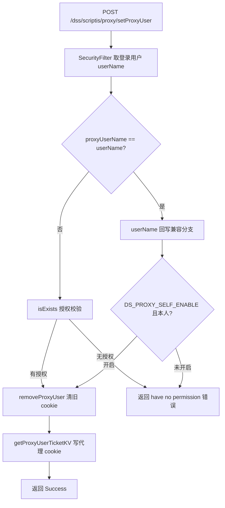
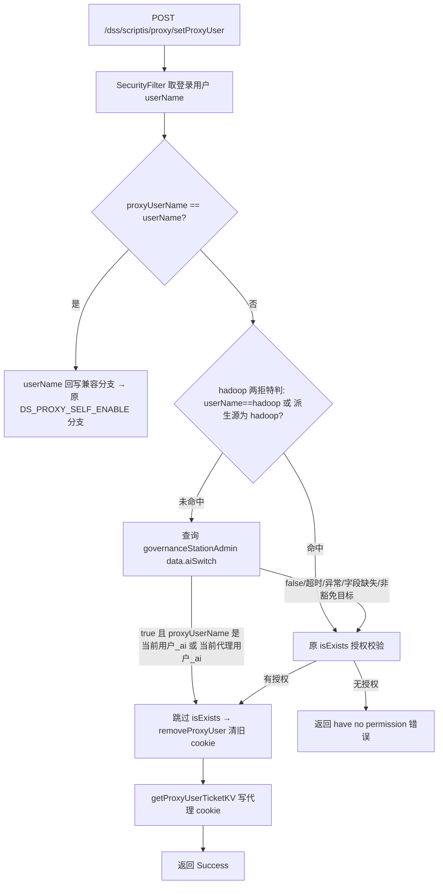

# [Scriptis][代理用户切换][功能增强] 新增AI用户切换（aiSwitch开启时免代理授权校验，直接切换至_ai用户）

---

## 📋 需求速览

| 维度 | 内容 |
|-----|------|
| **一句话描述** | setProxyUser 在 Linkis aiSwitch=true 时，对「当前用户+_ai」与「当前代理用户+_ai」目标跳过代理授权校验（isExists），直接切换写 cookie |
| **基础模块** | dss-framework-proxy-user-service（DssProxyUserController.setProxyUserCookie） |
| **增强目的** | AI 通道用户（`<user>_ai`）无需逐个配置代理授权记录即可完成切换，降低运营授权配置成本 |
| **功能范围** | P0: 3个 · P1: 0个 · P2: 0个 |
| **兼容性要求** | 100% 向后兼容（aiSwitch=false 或接口异常时，行为与现网完全一致） |
| **人力投入预估** | 0.5 人天（开发0.2 + 自测0.3） |
| **涉及模块** | dss-framework/dss-framework-proxy-user-service、dss-apps/dss-scriptis-server（路由继承，无代码改动） |

### 功能属性标签

| 属性类型 | 检测到的属性 |
|:--------:|-------------|
| **前端属性** | 无（纯后端需求） |
| **后端属性** | `业务逻辑` `接口扩展` `向后兼容` `外部依赖` |
| **数据属性** | 无（不涉及数据/表结构变更） |

> 💡 **阅读指引**：速览全貌看本卡片 → 现有功能看第二章 → 增强详情看第四章 → 技术实现看设计文档

---

**需求类型**: ENHANCE（功能增强）
**基础模块**: dss-framework-proxy-user-service（Scriptis 代理用户切换）
**文档版本**: v1.1（Stage 1.1 检视后修订：采纳 OPT-001~003 全部 3 项 RECOMMENDED，无 CRITICAL）
**创建日期**: 2026-11-12
**作者**: ryanchen（主会话内联生成，req-enhance-feature-analyzer 子代理因模型白名单403降级；Stage 1.1 req-recheck-orchestrator 亦内联降级执行）
**文档状态**: 检视后修订

---

## 一、需求背景 【核心】

### 1.1 业务背景

**场景**：企金 MCP 通道将调用用户统一切换为独立身份 `<user>_ai`（如 alexyang → alexyang_ai），该身份体系已在 LinkisV2.1.4 网关侧落地（`_ai` 用户 token 降级鉴权）；LinkisV2.1.7 REQ-01 通过 `governanceStationAdmin` 接口以 `data.aiSwitch` 向消费方下发集群级 `_ai` 能力开关（`linkis.ai.user.enable`，默认 false，热加载）。

**痛点**：DSS 侧 `/dss/scriptis/proxy/setProxyUser` 对所有非本人目标强制执行代理授权校验（`dssProxyUserService.isExists(userName, proxyUserName, workspace)`，即 dss_proxy_user 授权表）。`_ai` 用户作为机器身份不会预先配置授权记录，导致 aiSwitch 开启后用户仍无法切换到 `_ai` 身份，AI 通道在 DSS 侧断链。

**价值**：aiSwitch=true 时对「当前用户+_ai」「当前代理用户+_ai」目标豁免授权校验，AI 通道用户无感直切；aiSwitch=false（默认）时全部行为与现网一致，可安全灰度。

#### 用户场景分层（问答类功能适用）

> 不适用：本需求为后端鉴权链路增强，无问答/检索/对话属性。

### 1.2 系统背景

现有校验逻辑位于 `DssProxyUserController.setProxyUserCookie`（dss-framework-proxy-user-service），经 `ScriptisProxyUserController`（`@RequestMapping("/dss/scriptis/proxy")`）继承暴露为 `/dss/scriptis/proxy/setProxyUser`。增强点在既有校验分支内追加一个前置条件判断，属组件边界内的局部增强，不改变授权表结构与授权管理流程。

### 1.3 需求范围

| 属性 | 值 |
|-----|-----|
| 一级模块 | Scriptis |
| 二级模块 | 代理用户切换（proxy） |
| 功能属性 | [后端] |
| 前端开发类型 | 不涉及前端 |
| 涉及模块 | dss-framework/dss-framework-proxy-user-service（唯一代码改动点） |
| 涉及外部组件/外部系统/下游组件 | Linkis jobhistory `governanceStationAdmin`（只读消费，已由 LinkisV2.1.7 REQ-01 在 release_v2.1.7 落地，commit 81f5fd117） |

### 1.4 边界定义

| ✅ 包含（In Scope） | ❌ 不包含（Out of Scope） |
|-------------------|------------------------|
| setProxyUser 链路内查询 governanceStationAdmin 并解析 data.aiSwitch | 前端任何改动（勾选框展示由前端项目组负责） |
| aiSwitch=true 时对「当前用户+_ai」「当前代理用户+_ai」目标跳过 isExists 校验 | 「任意 _ai 后缀目标」豁免（用户已修正口径：仅限上述两类） |
| governanceStationAdmin 不可达/超时/字段缺失时回退原 isExists 校验 | hadoop 相关切换 _ai（明确禁止，硬约束，见 R2.1 两拒口径） |
| 切换行为审计留痕（LOGGER，沿用现有格式） | Linkis 侧 governanceStationAdmin 实现与配置（`linkis.ai.user.enable`） |
| | getProxyUser/getProxyUserList/add/revokeProxyUser 等既有接口与授权管理流程 |
| | 本人切换分支（DS_PROXY_SELF_ENABLE）语义 |

### 1.5 术语定义

| 术语 | 定义 | 所属领域 |
|-----|------|:--------:|
| `_ai` 用户 | 登录用户名（或代理用户名）加 `_ai` 后缀派生的 AI 通道身份（如 alexyang_ai），后缀常量 `linkis.ai.user.suffix` 默认 `_ai` | 技术 |
| aiSwitch | Linkis `governanceStationAdmin` 接口 `data.aiSwitch` 字段（JSON 原生布尔），取自集群配置 `linkis.ai.user.enable`（默认 false，热加载） | 技术 |
| governanceStationAdmin | Linkis jobhistory 管理信息接口，服务内路径 `/jobhistory/governanceStationAdmin`，经 linkis-mg 网关路由为 `/api/jobhistory/governanceStationAdmin`（网关白名单内，免登录可调）；**DSS 后端调用的完整基址与配置来源由设计文档闭合（OPT-001）** | 技术 |
| 代理授权校验 | `dssProxyUserService.isExists(userName, proxyUserName, workspace)`：查询用户对目标代理用户的授权记录 | 业务 |
| 当前代理用户 | 请求 cookie 中已生效的代理用户（`ProxyUserSSOUtils` 口径，读取方式设计文档闭合），未切换代理时为空 | 技术 |

---

## 二、现有功能分析 【核心】

### 2.1 现有功能描述

`POST /dss/scriptis/proxy/setProxyUser`（`ScriptisProxyUserController` 继承 `DssProxyUserController.setProxyUserCookie`）现行为：

1. `SecurityFilter.getLoginUsername(req)` 取登录用户名，写入 `userRep.userName`；校验 userName/proxyUserName 非空；
2. 兼容分支：`proxyUserName == username` 时以 proxyUserName 回写 userName（linkis `_c` 后缀场景）；
3. `SSOHelper.getWorkspace(req)` 取工作空间；
4. **授权校验**：`(DS_PROXY_SELF_ENABLE && userName equalsIgnoreCase proxyUserName) || dssProxyUserService.isExists(userName, proxyUserName, workspace)` → 通过则 `ProxyUserSSOUtils.removeProxyUser(...)` 清旧 cookie；不通过返回 `Message.error("user X have no permission to proxy to user Y")`；
5. 通过后 `ProxyUserSSOUtils.getProxyUserTicketKV(proxyUserName, DS_TRUST_TOKEN)` 生成代理票据 cookie（maxAge=-1，ssl 时 secure，domain=DomainUtils.getCookieDomain(req)，path=/），返回 `Message.ok("Success to add proxy user into cookie.")`。

### 2.2 当前痛点

| 痛点ID | 痛点描述 | 影响范围 | 影响程度 |
|--------|---------|---------|:--------:|
| P1 | `_ai` 机器身份无预配置授权记录，isExists 恒 false，切换被拒 | AI 通道全部调用用户 | 高 |
| P2 | 为 `_ai` 用户逐个补授权记录运营成本高且易漏 | 平台运维 | 中 |

### 2.3 现有功能依赖

- **调用方（前端）**：`web/packages/scriptis/module/setting/index.vue`、`web/packages/exts/open-source/proxyUser/modal.vue`（本需求不改）；
- **继承方**：`dss-apps/dss-scriptis-server` `ScriptisProxyUserController`（/dss/scriptis/proxy）、`dss-framework/dss-framework-release-server-webank` `ProxyUserController`（自动继承增强行为）；
- **依赖服务**：`DssProxyUserService`（授权表查询）、Linkis `ProxyUserSSOUtils`/`SecurityFilter`/`Message`。

---

## 三、核心流程 【核心】

> 功能属性=后端 → 服务调用流程。

### 3.1 增强前流程

### 3.2 增强后流程

### 3.3 原型提示（可选，仅涉及前端时填写）

> 不适用：纯后端需求。

---

## 四、增强需求详情 【核心】

### 4.1 功能总览

| ID | 增强点 | 优先级 | 状态 | 一句话描述 |
|----|-------|:------:|:----:|----------|
| E1 | aiSwitch 查询 | P0 | ✅ 已确认 | DSS 后端调用 governanceStationAdmin 并解析 data.aiSwitch |
| E2 | _ai 目标豁免授权校验 | P0 | ✅ 已确认 | aiSwitch=true 且目标∈{当前用户+_ai, 当前代理用户+_ai} 时跳过 isExists（hadoop 两拒除外） |
| E3 | 降级回退 | P0 | ✅ 已确认 | 接口异常/aiSwitch=false/非豁免目标/hadoop 相关时走原校验 |

---

### 4.2 增强详述

#### E1: aiSwitch 查询 `P0` `已确认`

**增强描述**
setProxyUser 处理链路内，DSS 后端向 Linkis 查询集群级 `_ai` 能力开关，作为豁免判定的唯一输入。查询失败不影响现有行为（降级为不豁免）。

**输入变化**
| 输入项 | 变化类型 | 说明 | 约束 |
|-------|:--------:|------|------|
| governanceStationAdmin 响应 | 新增消费 | `GET` governanceStationAdmin（服务内路径 `/jobhistory/governanceStationAdmin`，mg 网关路由 `/api/jobhistory/governanceStationAdmin`；**调用基址（网关地址/直连地址）与配置项来源由设计文档明确**，OPT-001） | 解析 `data.aiSwitch`（JSON 原生布尔）；超时上限设计阶段定（建议 ≤3s） |

**输出变化**
| 输出项 | 变化类型 | 说明 |
|-------|:--------:|------|
| 内存布尔 aiSwitch | 新增（内部） | 仅本请求生命周期内使用，不持久化 |

**业务规则**
| 规则ID | 规则描述 |
|--------|---------|
| R1.1 | aiSwitch 取值以当次请求实时查询为准，不做本地缓存（开关热加载语义对齐） |
| R1.2 | 接口不可达/超时/非0 status/JSON 解析失败/data.aiSwitch 缺失或类型非法 → 一律视为 aiSwitch=false（降级），warn 日志留痕（**含完整请求 URL、异常类型、耗时**，OPT-003） |
| R1.3 | 查询调用不携带、不产生用户敏感数据；URL 在 linkis-mg 白名单内无需用户凭据 |

**验收标准（三段式）**

| 验证阶段 | 验收条件 |
|:--------:|---------|
| 【输入验证】 | AC1.1: DSS 后端可成功 GET governanceStationAdmin 并读取 data.aiSwitch（原生布尔），联调环境实测（按设计文档闭合的基址口径） |
| 【处理验证】 | AC1.2: 接口返回 status=0 且 data.aiSwitch=true 时判定为 true；其余全部情形判定为 false，不抛未捕获异常 |
| 【输出验证】 | AC1.3: 降级路径下 setProxyUser 响应与现网（基线）完全一致 |

---

#### E2: _ai 目标豁免授权校验 `P0` `已确认`

**增强描述**
aiSwitch=true 时，目标代理用户为「当前登录用户+_ai」或「当前代理用户+_ai」的切换请求跳过 isExists 授权校验，直接走清旧 cookie + 写代理 cookie 成功路径。

**输入变化**
| 输入项 | 变化类型 | 说明 | 约束 |
|-------|:--------:|------|------|
| 豁免目标集合 | 新增（内部） | {当前登录用户名+"_ai", 当前代理用户名+"_ai"}；当前代理用户取自请求 cookie 中已生效代理用户，无则仅剩前者 | 后缀沿用 Linkis 常量口径 `_ai`；目标匹配为精确全等；**派生源为 hadoop 时拒绝（R2.1 两拒）** |

**输出变化**
| 输出项 | 变化类型 | 说明 |
|-------|:--------:|------|
| setProxyUser 响应 | 行为变更（条件性） | 豁免命中时从「have no permission 错误」变为「Success」（原成功路径不变）；不豁免时响应与现网一致 |

**业务规则**
| 规则ID | 规则描述 |
|--------|---------|
| R2.1 | **hadoop 两拒特判**（判定次序最先）：请求者 `userName == "hadoop"`，或豁免目标派生源（当前用户/当前代理用户）为 `"hadoop"`（即目标 `hadoop_ai`）→ 均不豁免，走原校验（硬约束，OPT-002） |
| R2.2 | 豁免仅跳过 isExists 授权校验；本人切换分支（DS_PROXY_SELF_ENABLE）与所有前置参数校验保持不变 |
| R2.3 | 豁免命中与豁免拒绝均记 LOGGER 审计（沿用现有 "user {} try to add user proxy cookie" 格式，补充豁免结果） |
| R2.4 | 非豁免目标（含任意其他 _ai 后缀用户，如他人派生 otheruser_ai）不豁免，走原校验 |

**验收标准（三段式）**

| 验证阶段 | 验收条件 |
|:--------:|---------|
| 【输入验证】 | AC2.1: proxyUserName ∈ {当前用户+"_ai", 当前代理用户+"_ai"} 且 aiSwitch=true 且非 hadoop 两拒场景 → 跳过 isExists 切换成功（alexyang→alexyang_ai 实测） |
| 【处理验证】 | AC2.2: aiSwitch=true 但目标为他人派生 _ai（other_ai）→ 仍走 isExists 校验；userName=hadoop 或目标派生自 hadoop（hadoop_ai）→ 均不豁免 |
| 【输出验证】 | AC2.3: 豁免成功后代理 cookie（名/值/maxAge/domain/path）与原成功路径产物完全一致 |

---

#### E3: 降级回退 `P0` `已确认`

**增强描述**
governanceStationAdmin 不可用、超时、返回异常、aiSwitch=false、目标不在豁免集合、hadoop 两拒场景——任一情形下维持现网行为（原 isExists 校验链路逐字节不变）。

**输入变化**
| 输入项 | 变化类型 | 说明 | 约束 |
|-------|:--------:|------|------|
| 降级触发集合 | 新增（内部） | {调用失败, 超时, 响应非法, aiSwitch=false, 目标不豁免, hadoop 两拒} | 七种情形全部落入原校验分支 |

**输出变化**
| 输出项 | 变化类型 | 说明 |
|-------|:--------:|------|
| setProxyUser 响应 | 不变 | 与基线一致 |

**业务规则**
| 规则ID | 规则描述 |
|--------|---------|
| R3.1 | 降级路径零行为差异：错误文案、日志、cookie 行为与现网一致 |
| R3.2 | governanceStationAdmin 调用须设置超时，禁止无限等待阻塞切换请求 |

**验收标准（三段式）**

| 验证阶段 | 验收条件 |
|:--------:|---------|
| 【输入验证】 | AC3.1: linkis 不可达/返回缺失字段场景实测 → 切换行为与基线一致（有授权用户可切、无授权用户拒绝） |
| 【处理验证】 | AC3.2: aiSwitch=false 时全量请求（含 _ai 目标）走原 isExists，无豁免副作用 |
| 【输出验证】 | AC3.3: 基线对拍：aiSwitch=false 环境下 setProxyUser 请求/响应与未升级版本逐字段一致 |

---

### 4.3 异常场景处理

| 场景ID | 异常场景 | 处理方式 |
|--------|---------|---------|
| X1 | governanceStationAdmin 连接拒绝/超时 | 视为 aiSwitch=false，warn 留痕（URL/异常/耗时），走原校验 |
| X2 | 响应 status!=0 或 data 缺 aiSwitch 或类型非法 | 视为 aiSwitch=false，warn 留痕 |
| X3 | 豁免路径写 cookie 失败 | 沿用现有 try-catch：返回根因错误信息（与现网一致） |
| X4 | 当前代理用户 cookie 缺失 | 豁免集合退化为 {当前用户+"_ai"} 单元素 |

---

## 五、兼容性分析 【核心】

### 5.1 必须保持不变的功能

| 功能 | 说明 | 验证方式 |
|-----|------|---------|
| 本人切换分支 | DS_PROXY_SELF_ENABLE && userName==proxyUserName 语义不变 | 单测 + 回归 |
| 授权校验失败文案 | "user X have no permission to proxy to user Y" 不变 | 回归对拍 |
| getProxyUser/getProxyUserList/add/revokeProxyUser | 完全不触碰 | 回归 |
| 代理 cookie 产物 | getProxyUserTicketKV 路径与属性不变 | AC2.3 |

### 5.2 现有数据处理

| 数据类型 | 处理方式 | 说明 |
|---------|---------|------|
| dss_proxy_user 授权表 | 兼容（不变更） | 无DDL/DML变更 |
| 代理 cookie | 兼容 | 写入逻辑不变 |

### 5.3 接口兼容性

| 接口 | 兼容性 | 说明 |
|-----|:------:|------|
| POST /dss/scriptis/proxy/setProxyUser | ✅ 兼容 | 入参/出参结构不变，仅条件性行为增强 |
| GET /dss/scriptis/proxy/getProxyUser 等 | ✅ 兼容 | 无变化 |
| GET governanceStationAdmin | 🆕 新增消费 | DSS 侧只读调用，Linkis 侧已有接口（REQ-01 release_v2.1.7），仅追加字段 aiSwitch 对 DSS 可见 |

---

## 六、非功能需求 【重要】

| 类型 | 需求描述 | 目标值 |
|-----|---------|:------:|
| 性能 | setProxyUser 增强后响应时间（aiSwitch 查询叠加） | 较原路径增加 ≤ 1s（governanceStationAdmin 超时上限以内） |
| 兼容性 | 向后兼容 | 100%（aiSwitch=false 时零差异） |
| 安全 | 豁免范围收窄（本人派生目标+hadoop 两拒+降级回退），全程审计留痕 | 豁免判定零越权面 |

---

## 七、数据实体概述 【重要】

### 7.1 数据实体变化

| 实体名称 | 变化类型 | 变化说明 | 与现有实体关系 |
|---------|:--------:|---------|---------------|
| 无 | 无 | 不涉及任何数据实体/表结构变更 | — |

### 7.2 数据规模预估

不适用（无数据变更）。

---

## 八、关联影响分析 【参考】

📎 点击展开关联影响分析

| 影响对象 | 影响类型 | 影响描述 | 应对措施 |
|---------|---------|---------|---------|
| dss-framework-release-server-webank ProxyUserController | 自动继承 | 继承 DssProxyUserController，自动获得豁免行为 | 回归验证 release 路由行为 |
| dss-scriptis-server-webank | 无代码改动 | ITSM 导入代理用户逻辑与本需求正交 | 无 |
| Linkis jobhistory | 外部依赖 | governanceStationAdmin 已由 LinkisV2.1.7 REQ-01 落地（release_v2.1.7，commit 81f5fd117） | 联调确认部署版本含 aiSwitch 字段；未部署则降级 |
| 前端（web/packages） | 无改动 | 勾选框展示由前端项目组按 aiSwitch 自行处理 | 接口契约对齐（本需求前端不感知豁免逻辑） |

6. **提示词注入风险** ⭐v4.8：
   - 注入风险等级：N/A（非 Claude 插件/Agent/Skill/Command 需求）
   - 触发威胁：无
   - 防注入验收标准：不适用

---

## 九、风险识别 【参考】

⚠️ 点击展开风险分析

| 风险ID | 风险描述 | 概率 | 影响 | 应对措施 |
|--------|---------|:----:|:----:|---------|
| RISK1 | 目标部署 Linkis 版本未含 aiSwitch 字段（governanceStationAdmin 旧版无该字段） | 中 | 中 | R1.2 降级为 false，行为回退现网；上线前核对部署版本 |
| RISK2 | 豁免范围误放大（如实现成任意 _ai 后缀）引发越权 | 低 | 高 | AC2.2 边界用例（他人派生 _ai 拒绝）+ 代码评审 |
| RISK3 | hadoop 两拒特判遗漏或被绕过 | 低 | 高 | R2.1 判定次序 + AC2.2 用例 |
| RISK4 | governanceStationAdmin 超时拖慢切换请求 | 中 | 中 | R3.2 超时上限 + 降级 |
| RISK5 | 当前代理用户口径与 Linkis 侧 cookie 语义不一致 | 低 | 中 | 设计阶段对齐 ProxyUserSSOUtils 读取口径 |

---

## 十、回滚方案 【重要】

### 10.1 回滚触发条件

- 豁免判定引发越权投诉或安全事件；
- setProxyUser 基线行为回归失败（授权切换异常）。

### 10.2 回滚步骤

1. 回滚 DSS 发布包至上一版本（单模块改动，git revert 单提交即可）；
2. 无需任何配置/数据操作（aiSwitch=false 或 DSS 回滚后行为即回基线）。

### 10.3 数据回滚

无数据变更，无需数据回滚。

---

## 十一、测试关注点

1. **增强功能测试**：aiSwitch=true 下 当前用户_ai / 当前代理用户_ai 切换成功；hadoop 两拒；他人派生 _ai 拒绝。
2. **兼容性测试**：aiSwitch=false 全量基线对拍（本人切换、有授权切换、无授权拒绝三种请求响应逐字段一致）。
3. **回归测试**：getProxyUser/getProxyUserList/add/revokeProxyUser、release-server 继承路由。
4. **性能测试**：governanceStationAdmin 超时降级路径耗时在预算内。

---

## 十二、附录

### 澄清质量指标（LCF）

| 指标 | 值 | 说明 |
|-----|:---:|------|
| **必填项覆盖度** | 100% | 模板必填字段全部填写 |
| **检查点覆盖度** | 100% | 5 项待澄清问题全部确认（2026-11-12 需求方答复）+ Stage 1.1 检视 3 项优化全部采纳 |
| **综合完成度** | 100% | 澄清结论已固化至 context.md decisionLog |

📋 点击查看详细检查点状态

| 检查点 | 状态 | 说明 |
|-------|:----:|------|
| 增强边界明确 | ✅ | 仅 setProxyUser 链路；范围外清单见 §1.4 |
| 兼容性要求明确 | ✅ | 100% 向后兼容，降级七情形 |
| 验收标准完整 | ✅ | E1/E2/E3 三段式 AC 共 9 条（v1.1 含 hadoop 两拒） |
| 回归范围明确 | ✅ | §十一 测试关注点 |

### 相关文档

| 文档类型 | 链接 | 说明 |
|---------|------|------|
| 📐 设计文档 | [待生成] Stage 2 产出 | 调用基址口径/HTTP客户端选型/超时配置/豁免判定实现 |
| 🧪 Feature文件 | [待生成] Stage 6 产出 | BDD 测试用例 |
| 📎 Linkis 侧契约 | `wedatasphere-linkis` dev-2.1.7 分支 `docs/LinkisV2.1.7/requirements/REQ-01_支持_ai用户切换_需求.md` | aiSwitch 字段权威契约（实现在 incubator-linkis release_v2.1.7 commit 81f5fd117） |

### 术语表

| 术语 | 定义 |
|-----|------|
| _ai 用户 | 用户名/代理用户名 + `_ai` 后缀的 AI 通道身份 |
| aiSwitch | Linkis governanceStationAdmin 下发的集群级 _ai 能力开关（linkis.ai.user.enable） |
| DS_PROXY_SELF_ENABLE | DSS 允许切换到本人的开关（既有能力，本需求不触碰） |
| DS_TRUST_TOKEN | DSS 代理票据信任令牌（ProxyUserSSOUtils 写 cookie 用） |

### 更新日志

| 版本 | 日期 | 作者 | 变更说明 |
|------|------|------|---------|
| v1.0 | 2026-11-12 | ryanchen | 初版创建（含 2026-11-12 需求方澄清结论 5 项） |
| v1.1 | 2026-11-12 | ryanchen | Stage 1.1 检视后修订：OPT-001 调用基址口径移交设计闭合；OPT-002 hadoop 特判升级为两拒口径（请求者 hadoop 或派生源 hadoop 均不豁免）；OPT-003 降级 warn 补 URL/异常/耗时 |

## 需求风险摘要

### 风险等级概览

| 风险总数 | 高 | 中 | 低 |
| --- | --- | --- | --- |
| 5 | 5 | 0 | 0 |

### 风险概览

| 风险ID | 关联功能点 | 等级 | 类型 | 风险结论 | 影响范围 |
| --- | --- | --- | --- | --- | --- |
| R-001 | E1 aiSwitch 查询 E3 降级回退 | 高 | 依赖 | setProxyUser 处理链路内，DSS 后端向 Linkis 查询集群级 `_ai` 能力开关，作为豁免判定的唯一输入可能导致查询失败不影响现有行为（降级为不豁免） | dss-framework-proxy-user-service setProxyUser 链路 → linkis-mg 网关 → linkis-jobhistory governanceStationAdmin |
| R-002 | E2 _ai 目标豁免授权校验 | 高 | 模块链路 | 目标代理用户为「当前登录用户+_ai」或「当前代理用户+_ai」的切换请求跳过 isExists 授权校验可能导致直接走清旧 cookie + 写代理 cookie 成功路径 | setProxyUser 代理授权校验链路（isExists 豁免判定） |
| R-003 | E2 _ai 目标豁免授权校验 | 高 | 模块链路 | 继承 DssProxyUserController，自动获得豁免行为可能导致回归验证 release 路由行为 | dss-framework-release-server-webank ProxyUserController（继承方路由） |
| R-004 | E1 aiSwitch 查询 | 高 | 参数配置 | governanceStationAdmin 调用须设置超时可能导致禁止无限等待阻塞切换请求 | DSS 侧新增 governanceStationAdmin 调用基址/超时配置项（设计阶段闭合） |
| R-005 | E1 aiSwitch 查询 | 高 | 性能容量 | setProxyUser 增强后响应时间（aiSwitch 查询叠加）可能导致较原路径增加 ≤ 1s（governanceStationAdmin 超时上限以内） | setProxyUser 请求延迟（新增 governanceStationAdmin 同步调用叠加） |

### 测试要求

| 风险ID | 测试要求 | 判断依据 | 处理建议 |
| --- | --- | --- | --- |
| R-001 | 压测 可用性测试 依赖不可用降级验证：依赖系统：Linkis governanceStationAdmin；不可用方式：连接拒绝/超时/非0 status/JSON解析失败/字段缺失或类型非法；降级策略：一律视为 aiSwitch=false 走原校验，warn 留痕（URL/异常/耗时）；业务影响：豁免不可用但既有切换行为与现网一致 依赖超时验证：依赖系统：Linkis governanceStationAdmin；超时阈值：建议 ≤3s（设计阶段定）；超时后的业务行为：视为 aiSwitch=false，回退原 isExists 授权校验 依赖重试验证 | 需求事实：setProxyUser 处理链路内 DSS 后端新增对 Linkis governanceStationAdmin 的同步 HTTP 只读调用，解析 data.aiSwitch 作为豁免判定唯一输入。影响依据：结构化知识确认 DSS 系统对 Linkis 系统存在出向依赖关系；本次为该依赖上新增的运行时调用点。风险判断：governanceStationAdmin 不可达、超时、返回缺 aiSwitch 字段（目标部署 Linkis 版本低于该字段落地版本）时，豁免能力整体失效，开关开启环境下 _ai 用户切换退回被拒状态；既有切换行为不受影响（全部失败情形降级为不豁免）。缺失信息：各环境部署的 Linkis 版本是否含 aiSwitch 字段未逐环境核实；调用基址与超时上限未在需求阶段闭合。 | 设计阶段闭合调用基址配置项与超时上限，上线前逐环境核对部署版本含该字段，降级日志留痕含完整 URL/异常/耗时便于归因。 |
| R-002 | 下游联动验证 跨系统调用异常验证：调用方：切换请求用户；被调用方：DSS setProxyUser 授权校验链路；异常类型：越权目标（他人派生 _ai / hadoop 派生）；预期业务响应：不豁免，走原 isExists 校验并拒绝 级联失败恢复验证 | 需求事实：开关开启且目标属于豁免集合时跳过代理授权校验，豁免命中时响应由拒绝错误变为切换成功。影响依据：setProxyUser 是代理身份切换的唯一入口，豁免判定直接改变授权边界；结构化知识确认 DSS 系统存在下游依赖方。风险判断：若实现把豁免范围放大为任意 _ai 后缀目标（他人派生用户）、或 hadoop 两拒特判遗漏（请求者为 hadoop 或目标派生自 hadoop 的场景绕过），将造成越权切换；当前需求已以特判次序、精确全等匹配与边界验收用例收窄。缺失信息：当前代理用户的 cookie 读取口径需设计阶段闭合，口径不一致可能引入第二类派生源。 | 设计阶段明确当前代理用户读取口径并在代码评审中逐条核对豁免集合判定与特判次序；他人派生目标与 hadoop 派生目标拒绝场景纳入必测。 |
| R-003 | 下游联动验证 跨系统调用异常验证 级联失败恢复验证 | 需求事实：release-server 的 ProxyUserController 继承 DssProxyUserController，基类增强逻辑被两个继承控制器同时继承，继承方无代码改动即行为变化。影响依据：基类为唯一代码改动点，继承方路由（release 服务）随基类自动获得豁免行为；测试关注点已将 release-server 继承路由列入回归范围。风险判断：release 路由的实际调用方未逐一核实，若发布场景存在对原校验行为的隐性依赖，行为变化可能未被现有回归覆盖。缺失信息：release-server 路由下 setProxyUser 的实际调用方与调用频率未核实。 | 回归范围显式纳入 release-server 继承路由，联调阶段确认 release 路由下代理切换行为。 |
| R-004 | 压测 可用性测试 配置变更生效验证：配置项：governanceStationAdmin 调用基址/超时（名称设计定）；变更前值：无（新增）；变更后值：设计阶段闭合；生效范围：scriptis-server 全部实例；生效方式：设计阶段定 配置回滚验证 配置边界值验证：配置项：超时上限；合法边界：建议 ≤3s；非法边界：0 或未设置；预期保护行为：禁止无限等待，超时降级为 aiSwitch=false | 需求事实：调用基址（网关地址/直连地址）与配置项来源由设计文档明确，超时上限建议三秒以内设计阶段定。影响依据：基址与超时为豁免链路的唯一外部参数，配置错误（基址错误、超时未设置）直接导致豁免能力静默失效或切换请求阻塞。风险判断：配置项名称、原值、生效范围、生效方式均未在需求阶段闭合，属需求完整性缺口型风险而非确定性缺陷；需求已明确调用必须设置超时、禁止无限等待。缺失信息：配置项名称与生效范围未定；linkis-mg 网关地址在 DSS 侧的既有配置来源未核实。 | 设计文档闭合配置项定义（名称/默认值/生效范围/读取方式），上线前逐环境核对基址配置并纳入降级验证。 |
| R-005 | 压测：并发量：未提供；数据量：未提供；持续时间：未提供；吞吐量目标：未提供；延迟目标：较原路径增加 ≤ 1s（需求未量化基线）；资源阈值：未提供 可用性测试 容量评估验证 | 需求事实：非本人切换请求在原校验路径前新增一次同步 HTTP 调用，性能目标为较原路径增加不超过一秒（governanceStationAdmin 超时上限以内）。影响依据：setProxyUser 属用户交互路径（前端切换代理用户操作），延迟直接叠加到用户操作响应；governanceStationAdmin 为页面初始化高频接口。风险判断：正常路径（网关内网调用）延迟增量毫秒级可控；降级路径最坏情况切换请求阻塞至超时上限，对用户体验有实质影响；需求未提供压测或容量论证。缺失信息：governanceStationAdmin 现网延迟基线与切换请求量未提供。 | 设计阶段将超时上限收敛（内网调用建议亚秒级），测试阶段以降级路径实测耗时作为容量证据，延迟增量目标纳入测试计划。 |
